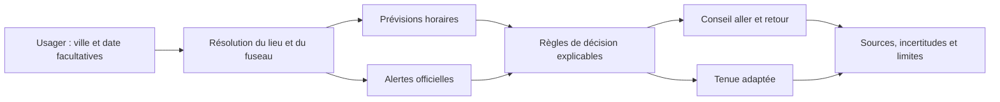

# Vision stratégique Ride-or-Drive : [PROJECT_NAME]

> **Template Origin**: Custom | **Based On**: `/arckit:strategy` | **ArcKit Version**: [VERSION] | **Command**: `/arckit-community.rideordrive`

## Document Control

<!-- DOC-CONTROL-HEADER -->
<!-- Resolved at command-execution time per _partials/RENDERING.md. -->

## Revision History

| Version | Date | Author | Changes | Approved By | Approval Date |
|---------|------|--------|---------|-------------|---------------|
| 1.0 | [DATE] | ArcKit AI | Première version de la vision stratégique Ride-or-Drive | [PENDING] | [PENDING] |

---

## 1. Synthèse exécutive

### 1.1 Vision stratégique

[Décrire l'état futur visé, les usagers concernés, la transformation recherchée et le lien avec les priorités de l'organisation. Distinguer l'ambition proposée d'une stratégie approuvée.]

### 1.2 Problème et opportunité

[Décrire les difficultés actuelles de déplacement, les besoins auxquels répondre et l'opportunité stratégique. Citer les éléments de preuve; indiquer les manques.] 

### 1.3 Recommandation stratégique

[Présenter l'option cible, le séquencement recommandé et la justification.]

### 1.4 Résultats attendus

| Résultat | Indicateur | Référence disponible | Cible proposée | Échéance | Statut / propriétaire |
|----------|------------|----------------------|----------------|----------|------------------------|
| Sécurité des recommandations | [Définition mesurable] | [Donnée ou inconnue] | [À VALIDER] | [À VALIDER] | [Rôle] |
| Qualité et traçabilité météo | [Part des recommandations sourcées et couvrant les trajets] | [Donnée ou inconnue] | [À VALIDER] | [À VALIDER] | [Rôle] |
| Adoption et expérience usager | [Usage, satisfaction, accessibilité] | [Donnée ou inconnue] | [À VALIDER] | [À VALIDER] | [Rôle] |
| Impact carbone des déplacements | [CO2e par trajet / substitution modale] | [Donnée ou inconnue] | [À VALIDER] | [À VALIDER] | [Rôle] |

Ne chiffre pas une réduction de CO2e sans scénario de référence, distances, modes de transport et facteurs d'émission vérifiables.

---

## 2. Contexte stratégique

### 2.1 Périmètre et parties prenantes

**Inclus** : [Usagers, zones, types de trajet, décisions ou services concernés.]  
**Exclus** : [Éléments hors périmètre.]  
**Sponsor / propriétaire** : [Rôle ou À VALIDER.]  
**Horizon stratégique** : [Période ou À VALIDER.]

| Partie prenante | Besoin / responsabilité | Influence | Mode d'engagement |
|-----------------|-------------------------|-----------|-------------------|
| Usagers / salariés | [À documenter] | [À VALIDER] | [À VALIDER] |
| Sponsor métier | [À documenter] | [À VALIDER] | [À VALIDER] |
| Mobilité / RH / opérations | [À documenter] | [À VALIDER] | [À VALIDER] |
| Sécurité / protection des données | [À documenter] | [À VALIDER] | [À VALIDER] |

### 2.2 Facteurs et contraintes

| Facteur | Fait, hypothèse ou inconnue | Source / validation requise | Conséquence stratégique |
|---------|-----------------------------|----------------------------|--------------------------|
| Besoins de déplacement | [État] | [Source] | [Conséquence] |
| Données météo et alertes | [État] | [Source] | [Conséquence] |
| Accessibilité et sécurité | [État] | [Source] | [Conséquence] |
| Émissions et objectifs climat | [État] | [Source] | [Conséquence] |
| Budget, technologie et exploitation | [État] | [Source] | [Conséquence] |

### 2.3 Hypothèses et inconnues

| ID | Énoncé | Statut | Responsable de validation | Échéance |
|----|--------|--------|----------------------------|----------|
| H-01 | [Hypothèse explicitement utilisée] | À valider | [Rôle] | [Date] |
| U-01 | [Information inconnue qui peut modifier la stratégie] | Ouverte | [Rôle] | [Date] |

---

## 3. Principes stratégiques

| ID | Principe | Implication pour Ride-or-Drive |
|----|----------|--------------------------------|
| RD-P-01 | La sécurité avant la préférence modale | Ne pas recommander le vélo face à un danger ou une alerte pertinente; afficher les limites connues. |
| RD-P-02 | Choisir selon le contexte du trajet | Évaluer séparément les trajets aller et retour, au lieu d'utiliser une moyenne journalière. |
| RD-P-03 | Une recommandation explicable | Présenter les données, sources, règles et incertitudes qui motivent chaque conseil. |
| RD-P-04 | Accessibilité et équité | Concevoir des options adaptées aux besoins des usagers, sans supposer que vélo ou voiture est accessible à tous. |
| RD-P-05 | Minimisation des données | Ne collecter ni conserver de localisation précise au-delà du besoin de calcul. |
| RD-P-06 | Mesurer l'impact avant de le revendiquer | Établir une référence et une méthode CO2e reproductible avant d'annoncer des réductions. |
| RD-P-07 | Limiter la dépendance fournisseur | Séparer règles de décision, sources météo et interface pour permettre une évolution maîtrisée. |

---

## 4. Options stratégiques

| Option | Description | Avantages | Limites / risques | Appréciation |
|--------|-------------|-----------|------------------|--------------|
| A — Statu quo | Conseils génériques ou décision individuelle sans aide structurée. | Coût et complexité initiaux faibles. | Décision peu contextualisée, difficile à mesurer ou à auditer. | [À compléter] |
| B — Aide ponctuelle Ride-or-Drive | Commande ArcKit qui combine localisation, météo horaire, alertes et règles explicables pour recommander vélo, vigilance ou voiture. | Valeur rapide, périmètre maîtrisé, sources visibles. | Dépendance à la qualité/disponibilité des données; ne connaît pas nécessairement le trajet réel. | [À compléter] |
| C — Service mobilité intégré | Intégration à des outils de mobilité, de trajet ou d'entreprise, avec données et mesures d'usage dans la durée. | Expérience et pilotage potentiellement plus complets. | Investissement, gouvernance, vie privée et intégration à valider. | [À compléter] |

### 4.1 Choix recommandé

[Option retenue et raisons. Si les preuves sont limitées, recommander un pilote réversible et indiquer les conditions de passage à l'échelle.]

---

## 5. État cible

### 5.1 Expérience cible

[Décrire le parcours : ville/date facultatives, résolution du lieu et du fuseau, collecte des données météo horaires et alertes, évaluation séparée de l'aller et du retour, recommandation, vêtements, sources et limites.]

### 5.2 Capacités nécessaires

| Capacité | État actuel / preuve | État cible | Écart / action | Responsable |
|----------|----------------------|------------|----------------|-------------|
| Résolution du lieu et du fuseau | [À documenter] | [Décrire] | [Action] | [Rôle] |
| Prévisions horaires et alertes | [À documenter] | [Décrire] | [Action] | [Rôle] |
| Règles vélo / vigilance / voiture | [À documenter] | [Décrire] | [Action] | [Rôle] |
| Accessibilité, sécurité et confidentialité | [À documenter] | [Décrire] | [Action] | [Rôle] |
| Mesure d'adoption et impact CO2e | [À documenter] | [Décrire] | [Action] | [Rôle] |

### 5.3 Flux cible

Le flux ne prouve pas l'état du trajet, des routes ou des pistes cyclables; ces données exigent une source distincte.

---

## 6. Feuille de route

| Phase | Résultat | Travaux principaux | Critère de sortie | Décision |
|-------|----------|-------------------|-------------------|----------|
| 1. Cadrage | Besoins, périmètre, propriétaires et politiques confirmés | Ateliers usagers, inventaire des sources, validation sécurité/confidentialité | Hypothèses critiques validées et risques attribués | Poursuivre / réviser |
| 2. Pilote | Commande ArcKit éprouvée sur un périmètre limité | Vérification des sources, tests des fenêtres, scénarios d'alertes et de données manquantes | Résultats vérifiables, retours usagers et critères de sécurité acceptés | Étendre / corriger / arrêter |
| 3. Mesure | Référence d'usage et méthode d'impact établies | Instrumentation proportionnée, enquête, données de trajet agrégées si autorisées | Méthode CO2e approuvée; cibles proposées et validées | Passage à l'échelle |
| 4. Évolution | Service intégré si la valeur est démontrée | Évaluation des intégrations, fournisseurs, coûts et gouvernance | Analyse de valeur et approbations disponibles | Investir / maintenir le pilote |

Aucune date, enveloppe budgétaire ou cible d'adoption n'est supposée sans validation.

---

## 7. Mesure et gouvernance

| Indicateur | Définition / formule | Source nécessaire | Référence | Cible approuvée | Fréquence / propriétaire |
|------------|----------------------|------------------|-----------|-----------------|--------------------------|
| Couverture des trajets | Part des rapports avec données horaires couvrant les deux fenêtres | Journaux de qualité minimisés | [À établir] | [À VALIDER] | [À VALIDER] |
| Traçabilité | Part des recommandations citant prévisions et statut des alertes | Rapports générés | [À établir] | [À VALIDER] | [À VALIDER] |
| Fiabilité des règles | Résultats de tests de pluie, vent, alertes et données manquantes | Suite de tests / revues | [À établir] | [À VALIDER] | [À VALIDER] |
| Adoption et satisfaction | Utilisation et retour volontaire des usagers | Mesure respectueuse de la vie privée | [À établir] | [À VALIDER] | [À VALIDER] |
| Impact CO2e | Différence d'émissions par rapport à une référence approuvée | Distances, modes, période et facteurs d'émission | [À établir] | [À VALIDER] | [À VALIDER] |

**Gouvernance** : [Forum décisionnel, propriétaire de la stratégie, approbateurs des règles et responsables de la revue.]  
**Révision** : [Périodicité et événements déclencheurs : changement de source, incident, alerte manquée, évolution de politique ou données nouvelles.]

---

## 8. Risques et garde-fous

| ID | Risque | Probabilité / impact | Réponse | Propriétaire |
|----|--------|---------------------|---------|--------------|
| RD-R-01 | Prévision incomplète, retardée ou erronée | [À évaluer] | Afficher fraîcheur et couverture; refuser une recommandation ferme si les données manquent. | [Rôle] |
| RD-R-02 | Fausse assurance sur la sécurité du vélo | [À évaluer] | Donner priorité aux alertes officielles; rappeler que routes et itinéraires ne sont pas évalués. | [Rôle] |
| RD-R-03 | Exposition de données de localisation | [À évaluer] | Minimiser, éviter la conservation et documenter tout traitement nécessaire. | [Rôle] |
| RD-R-04 | Recommandation non accessible ou inéquitable | [À évaluer] | Consulter les usagers et ne pas présenter le vélo ou la voiture comme option universelle. | [Rôle] |
| RD-R-05 | Allégation carbone non démontrée | [À évaluer] | Publier une méthode et une référence vérifiables avant de revendiquer un bénéfice CO2e. | [Rôle] |

---

## 9. Décisions et questions ouvertes

| ID | Décision / question | Proposition ou information nécessaire | Décideur | Échéance | Statut |
|----|---------------------|---------------------------------------|----------|----------|--------|
| RD-D-01 | Confirmer le périmètre et les usagers de SCR | [À VALIDER] | [Rôle] | [Date] | Ouvert |
| RD-D-02 | Approuver les sources météo et d'alerte | [À VALIDER] | [Rôle] | [Date] | Ouvert |
| RD-D-03 | Définir les objectifs de mobilité et CO2e | Référence, période, facteurs d'émission et cibles | [Rôle] | [Date] | Ouvert |
| RD-D-04 | Décider du pilote et de ses critères de sécurité | [À VALIDER] | [Rôle] | [Date] | Ouvert |

---

**Généré par** : ArcKit `/arckit-community.rideordrive`  
**Généré le** : [DATE]  
**Version ArcKit** : [VERSION]  
**Projet** : [PROJECT_ID] — [PROJECT_NAME]  
**Statut** : [Brouillon / À valider / Approuvé]

---

## 10. Annexe — Exemple d'application ponctuel
---

Cet exemple est un instantané météo pour Marseille daté du 13 octobre 2026. Il illustre la restitution attendue; il ne constitue ni une observation vérifiée sur le terrain, ni une baseline, ni une tendance stratégique. Remplacer ces données par une source actualisée lors de toute nouvelle exécution.

### Localisation et sources

- **Ville** : Marseille 13000, France
- **Fuseau horaire** : Europe/Paris (UTC+2)
- **Données** : prévisions Open-Meteo à 15 minutes; consultation du lendemain jour ouvré (Lundi au vendredi)
- **Vigilance officielle** : bulletin Météo-France émis à 06:00 Le niveau/couleur n'a pas pu être confirmé à partir de la page consultée; ne pas en tenir compte.

### Trajet du matin — 07:00 à 09:00

- Température : 16,9 à 19,2 °C; ressentie : 17,1 à 19 °C.
- Précipitations : 0 mm; probabilité : 0 %.
- Vent maximal : 9,9 km/h à 07:45; rafales maximales : 20,2 km/h à 07:00.
- **Tenue conseillée** : manches courtes ou manches longues légères, avec une couche légère; coupe-vent léger facultatif. Pas de gants nécessaires en conditions normales.

### Trajet du soir — 17:00 à 19:30

- Température : 23,1 à 24,1 °C; ressentie : 21,8 à 22,3 °C.
- Précipitations : 0 mm; probabilité : 0 %.
- Vent maximal : 22 km/h à 18:00; rafales maximales : 39,2 km/h entre 18:15 et 18:30.
- **Tenue conseillée** : manches courtes; couche légère facultative selon le confort. Pas de gants ni de bonnet nécessaires en conditions normales.

### Recommandation de cet exemple

**VÉLO POSSIBLE AVEC VIGILANCE** — les données météo des deux trajets sont sèches et le vent reste modéré, mais le niveau de vigilance officiel n'a pas pu être vérifié. Consulter Météo-France avant le départ. La météo ne renseigne pas l'état des routes ou des pistes cyclables.

### Sources de l'exemple

- [Prévisions horaires Open-Meteo pour Marseille le 13 octobre 2026](https://api.open-meteo.com/v1/forecast?latitude=43.2965&longitude=5.3698&minutely_15=temperature_2m,apparent_temperature,precipitation_probability,precipitation,weather_code,wind_speed_10m,wind_gusts_10m&timezone=Europe%2FParis&start_minutely_15=2026-10-13T07:00&end_minutely_15=2026-10-13T19:30)
- [Vigilance Météo-France — Bouches-du-Rhône](https://vigilance.meteofrance.fr/fr/bouches-du-rhone)
