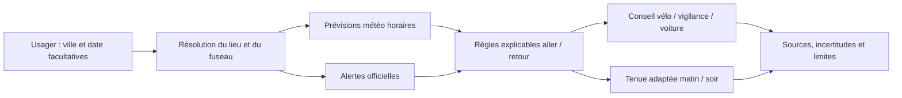

# Vision stratégique Ride-or-Drive : SCR

> **Template Origin**: Custom | **Based On**: `/arckit:strategy` | **ArcKit Version**: 6.18.2 | **Command**: `/arckit-community.rideordrive`

## Document Control

<!-- DOC-CONTROL-HEADER -->
<!-- Resolved at command-execution time per _partials/RENDERING.md. -->

## Revision History

| Version | Date | Author | Changes | Approved By | Approval Date |
|---------|------|--------|---------|-------------|---------------|
| 1.0 | 2026-10-13 | ArcKit AI | Première version de travail de la vision Ride-or-Drive | [PENDING] | [PENDING] |

---

## 1. Synthèse exécutive

### 1.1 Vision stratégique

**Vision proposée, à valider** : permettre aux usagers de choisir le mode de déplacement domicile-travail le plus approprié au contexte du trajet, en privilégiant le vélo lorsque les conditions connues le permettent et en recommandant une alternative lorsque les prévisions ou les alertes signalent un risque. Le service doit rendre sa recommandation compréhensible, localisée, sourcée et révisable; il ne doit jamais présenter une prévision météo comme une garantie de sécurité.

SCR est cadré ici comme une capacité ArcKit d'aide à la décision Ride-or-Drive, et non comme une politique d'entreprise déjà approuvée. Le dossier projet ne contient pas encore de vision, d'exigences, de données d'usage, de politiques de déplacement ou d'objectifs organisationnels propres à SCR. Cette version est donc un brouillon stratégique fondé sur le périmètre demandé dans la conversation.

### 1.2 Problème et opportunité

Une recommandation générique « vélo ou voiture » ignore que les trajets aller et retour peuvent rencontrer des conditions différentes. Une aide contextualisée peut présenter les conditions horaires, les alertes officielles, les limites des sources et des conseils vestimentaires séparés, afin que l'usager prenne une décision informée.

L'opportunité est de structurer cette aide dans ArcKit comme une expérience reproductible plutôt que de laisser les règles et les sources implicites. Le bénéfice potentiel sur la sécurité, l'adoption du vélo ou les émissions reste à mesurer; aucune réduction de CO2e n'est revendiquée dans ce document.

### 1.3 Recommandation stratégique

Adopter une approche progressive : cadrer le périmètre et les règles avec les usagers et les responsables métier; piloter une commande ArcKit reposant sur des prévisions horaires et des alertes officielles; mesurer la qualité et l'adoption; n'envisager une intégration plus large qu'après validation de la valeur, des risques, des coûts et des exigences de confidentialité.

### 1.4 Résultats attendus

| Résultat | Indicateur | Référence disponible | Cible proposée | Échéance | Statut / propriétaire |
|----------|------------|----------------------|----------------|----------|------------------------|
| Recommandations de trajet traçables | Chaque résultat expose les sources, fenêtres horaires et données manquantes | Prototype de prompt et template présents dans le dépôt | Cible à valider après pilote | À définir | À valider |
| Décisions prudentes et explicables | Tests couvrant pluie, vent, alertes, couverture et incertitudes | Cas de test du skill disponibles; validation projet à organiser | Aucun défaut critique dans les cas approuvés | À définir | À valider |
| Expérience utile et accessible | Adoption, compréhension et satisfaction des usagers | Inconnue | À établir par recherche utilisateur | À définir | À valider |
| Impact carbone mesurable | Émissions par trajet et substitution modale | Aucune donnée de distance, mode de référence ou facteur d'émission projet | Établir une méthode avant de fixer une cible | À définir | À valider |

---

## 2. Contexte stratégique

### 2.1 Périmètre et parties prenantes

**Inclus** : aide à la décision quotidienne vélo/voiture pour des trajets domicile-travail; ville/date; prévisions horaires; alertes météo; conseil vestimentaire; sources et incertitudes.  
**Exclus à ce stade** : navigation, évaluation d'itinéraire, état des routes ou pistes, réservation de transport, politique flotte, conseil médical ou garantie de sécurité.  
**Sponsor / propriétaire** : à désigner.  
**Horizon stratégique** : à confirmer au cadrage; la feuille de route ci-dessous est organisée par phases, sans dates calendaires inventées.

| Partie prenante | Besoin / responsabilité | Influence | Mode d'engagement |
|-----------------|-------------------------|-----------|-------------------|
| Usagers / salariés | Conseils utiles pour les trajets et besoins d'accessibilité | À évaluer | Entretiens et pilote |
| Sponsor métier | Valider le périmètre, les critères de valeur et le risque accepté | À désigner | Décision de cadrage et revues |
| Mobilité / RH / opérations | Confirmer les trajets, options disponibles et processus de support | À désigner | Ateliers de conception |
| Sécurité / protection des données | Examiner les alertes, limites de responsabilité et données de localisation | À désigner | Revue avant pilote |

### 2.2 Facteurs et contraintes

| Facteur | Fait, hypothèse ou inconnue | Source / validation requise | Conséquence stratégique |
|---------|-----------------------------|----------------------------|--------------------------|
| Besoin de mobilité domicile-travail | Demande exprimée pour un choix vélo/voiture guidé par la météo | Conversation de cadrage; valider avec les usagers visés | Concevoir d'abord un service d'information, pas une politique de déplacement |
| Ville par défaut | Marseille 13000, France, dans les instructions existantes | Prompt Ride-or-Drive | Toujours donner priorité à une ville explicitement saisie |
| Données météo | Des sources horaires publiques peuvent fournir température, ressenti, pluie et vent | Vérifier disponibilité, licence, fraîcheur et couverture du fournisseur retenu | Prévoir l'échec de source et rendre les données traçables |
| Alertes officielles | Météo-France est la référence envisagée pour la France | Vérifier le niveau, les phénomènes et la période à chaque exécution | Ne pas déduire l'absence d'alerte si la source ne la restitue pas |
| Émissions | Aucun historique de trajets SCR n'est fourni | Définir baseline, distances, modes et facteurs d'émission | Mesurer avant toute allégation CO2e |
| Gouvernance et budget | Non documentés | Sponsor et propriétaires à désigner | Garder le pilote réversible et les coûts non engagés jusqu'à validation |

### 2.3 Hypothèses et inconnues

| ID | Énoncé | Statut | Responsable de validation | Échéance |
|----|--------|--------|----------------------------|----------|
| H-01 | SCR désigne une capacité d'aide aux trajets domicile-travail, et non une organisation ou un programme déjà documenté | Hypothèse de cadrage | Sponsor SCR | Avant approbation |
| H-02 | L'utilisateur peut choisir entre vélo et voiture; ces options ne sont pas nécessairement disponibles ni accessibles à chacun | Hypothèse à confirmer | Métier / usagers | Cadrage |
| U-01 | Population, zones, trajets types, pratiques actuelles et contraintes d'accessibilité | Inconnu | Métier / usagers | Cadrage |
| U-02 | Sources météo autorisées, licences, SLA, coûts, localisation et fuseaux supportés | Inconnu | Technique / achats | Avant pilote |
| U-03 | Baseline modale, distances, émissions, budget, cible carbone et horizon approuvés | Inconnu | Sponsor / climat / finance | Avant engagement de bénéfices |

---

## 3. Principes stratégiques

| ID | Principe | Implication pour Ride-or-Drive |
|----|----------|--------------------------------|
| RD-P-01 | La sécurité avant la préférence modale | Une alerte ou un danger connu prime sur une préférence vélo; les limites sont visibles. |
| RD-P-02 | Choisir selon le contexte du trajet | Aller et retour sont évalués séparément avec des données locales et horaires. |
| RD-P-03 | Une recommandation explicable | Chaque conseil est relié aux valeurs, sources, règles et incertitudes utilisées. |
| RD-P-04 | Accessibilité et équité | Ne pas supposer que vélo ou voiture convient à tous; valider les besoins avec les usagers. |
| RD-P-05 | Minimisation des données | Résoudre la ville pour la prévision sans conserver la localisation précise sans besoin justifié. |
| RD-P-06 | Mesurer avant de revendiquer | Les bénéfices CO2e exigent une méthode, une référence et des données vérifiables. |
| RD-P-07 | Limiter la dépendance fournisseur | Isoler la source météo afin de pouvoir la remplacer sans réécrire les règles métier. |

---

## 4. Options stratégiques

| Option | Description | Avantages | Limites / risques | Appréciation |
|--------|-------------|-----------|------------------|--------------|
| A — Statu quo | Conseil générique, sans données horaires ni règles partagées | Faible effort initial | Faible traçabilité; différences aller/retour ignorées | Ne répond pas au besoin exprimé |
| B — Aide ponctuelle ArcKit | Commande qui analyse les deux trajets, sources météo et alertes, puis explique mode et vêtements | Périmètre limité; valeur testable; décision lisible | Dépend des sources; ne connaît pas le parcours ni son état | **Recommandée pour un pilote** |
| C — Service mobilité intégré | Intégration de données de transport, parcours et mobilité d'entreprise | Peut soutenir une expérience et une mesure plus larges | Coûts, données personnelles, intégration et gouvernance non évalués | À réexaminer après pilote |

### 4.1 Choix recommandé

Commencer par l'option B avec un périmètre pilote, sans automatiser une décision à la place de l'usager. Définir des critères d'arrêt en cas de données horaires insuffisantes, d'alerte pertinente, d'incident ou de résultats incohérents. Ne passer à l'option C que si le pilote démontre une utilité, une maîtrise des risques et une méthode de mesure acceptable.

---

## 5. État cible

### 5.1 Expérience cible

L'usager peut indiquer une ville et une date; à défaut, Marseille 13000 et la date locale sont utilisées. Le service résout le lieu et le fuseau, consulte une prévision horaire et la vigilance officielle, analyse séparément 07:00–09:00 et 17:00–19:30, puis restitue les valeurs utiles, la recommandation, les vêtements et les limites. Une donnée manquante est affichée comme telle; une météo journalière générale ne remplace pas les valeurs horaires.

La recommandation reste une aide à la décision. Le service n'affirme ni connaître les pistes et routes, ni garantir la sécurité, ni mesurer le carbone sans données et facteurs vérifiés.

### 5.2 Capacités nécessaires

| Capacité | État actuel / preuve | État cible | Écart / action | Responsable |
|----------|----------------------|------------|----------------|-------------|
| Résolution du lieu et du fuseau | Règle Marseille par défaut présente dans le prompt | Lieu explicite prioritaire; ville, date et fuseau visibles | Tester noms ambigus et codes postaux | À désigner |
| Prévisions horaires et alertes | Exemple ponctuel consulté; aucun fournisseur projet contractualisé | Source horodatée, deux fenêtres couvertes, vigilance officielle vérifiée | Confirmer source, licence, fraîcheur et repli | À désigner |
| Règles vélo / vigilance / voiture | Critères pluie, vent, alertes et incertitude formulés dans le prompt | Règles déterministes, testées et présentées à l'usager | Valider avec sécurité et usagers | À désigner |
| Accessibilité, sécurité et confidentialité | Pas d'analyse propre à une population SCR | Revue de conception, minimisation de localisation, alternatives inclusives | Collecter besoins et obtenir revues | À désigner |
| Mesure d'adoption et impact CO2e | Aucune baseline | Mesures de qualité et méthode carbone documentées | Établir baseline avant les cibles | À désigner |

### 5.3 Flux cible

Le flux ne détermine pas l'état du trajet, des routes ou des pistes cyclables; ces données nécessiteraient une source distincte.

---

## 6. Feuille de route

| Phase | Résultat | Travaux principaux | Critère de sortie | Décision |
|-------|----------|-------------------|-------------------|----------|
| 1. Cadrage | Périmètre, usagers et propriétaires confirmés | Ateliers; besoins d'accessibilité; politiques; choix de source et revue vie privée/sécurité | Hypothèses critiques validées et risques attribués | Poursuivre / réviser |
| 2. Pilote | Commande ArcKit vérifiée sur un périmètre limité | Tests pluie, vent, alertes, données manquantes et fuseaux; retours usagers | Sources traçables; cas de sécurité acceptés; utilité évaluée | Étendre / corriger / arrêter |
| 3. Mesure | Référence d'usage et méthode d'impact établies | Mesure proportionnée; validation baseline modale et méthode CO2e | Méthode et cibles approuvées avant toute allégation | Passage à l'échelle |
| 4. Évolution | Décision sur l'intégration à des services de mobilité | Évaluer coûts, fournisseurs, intégration, protection des données et bénéfices | Analyse de valeur et approbations disponibles | Investir / maintenir le pilote |

Les dates, budget et cibles sont à établir; aucune valeur n'est supposée dans cette version.

---

## 7. Mesure et gouvernance

| Indicateur | Définition / formule | Source nécessaire | Référence | Cible approuvée | Fréquence / propriétaire |
|------------|----------------------|------------------|-----------|-----------------|--------------------------|
| Couverture des trajets | Part des rapports couvrant les deux créneaux avec données horaires | Contrôle qualité de la réponse | À établir | À valider | À valider |
| Traçabilité | Part des recommandations citant la source et les incertitudes | Rapports générés | À établir | À valider | À valider |
| Fiabilité des règles | Résultats des tests pluie, vent, alertes, données absentes et fuseaux | Suite de tests | À établir | À valider | À valider |
| Adoption et satisfaction | Usage et retour volontaire des usagers | Mesure respectueuse de la vie privée | À établir | À valider | À valider |
| Impact CO2e | Émissions comparées à un scénario de référence approuvé | Distances, modes, période et facteurs d'émission | Non disponible | À valider après baseline | À valider |

**Gouvernance proposée** : désigner un sponsor métier, un propriétaire de règles, un responsable de la source et les approbateurs sécurité/confidentialité.  
**Révision** : après le pilote et lors d'un changement de source, d'une alerte manquée, d'un incident ou d'une évolution des politiques.

---

## 8. Risques et garde-fous

| ID | Risque | Niveau | Réponse | Propriétaire |
|----|--------|--------|---------|--------------|
| RD-R-01 | Prévision incomplète, retardée ou erronée | À évaluer | Afficher fraîcheur et couverture; refuser une recommandation ferme si les données manquent. | À désigner |
| RD-R-02 | Fausse assurance sur la sécurité du vélo | À évaluer | Priorité aux alertes officielles; expliciter que routes et itinéraires ne sont pas évalués. | À désigner |
| RD-R-03 | Exposition des données de localisation | À évaluer | Minimiser les données et éviter leur conservation sans justification. | À désigner |
| RD-R-04 | Service non adapté à certains usagers | À évaluer | Consulter les usagers et définir les limites et alternatives. | À désigner |
| RD-R-05 | Allégation carbone non démontrée | À évaluer | Valider baseline, facteurs d'émission et méthode avant de communiquer un gain. | À désigner |

---

## 9. Décisions et questions ouvertes

| ID | Décision / question | Proposition ou information nécessaire | Décideur | Statut |
|----|---------------------|---------------------------------------|----------|--------|
| RD-D-01 | Confirmer que SCR désigne l'aide ArcKit aux trajets domicile-travail | Valider le cadrage provisoire de ce document | Sponsor SCR | Ouvert |
| RD-D-02 | Confirmer les populations, zones et trajets visés | Recherche utilisateur et contraintes de mobilité | Métier / usagers | Ouvert |
| RD-D-03 | Approuver les sources météo et d'alerte | Fournisseurs, licence, fraîcheur, couverture et solution de repli | Technique / sécurité | Ouvert |
| RD-D-04 | Définir les objectifs de mobilité et CO2e | Baseline, facteurs et cibles approuvées | Sponsor / climat / finance | Ouvert |
| RD-D-05 | Autoriser le pilote et ses critères d'arrêt | Périmètre, sécurité, confidentialité, évaluation et responsables | Sponsor SCR | Ouvert |

---

## 10. Annexe — Exemple d'application ponctuel

### Prévision domicile-travail à Marseille — 13 octobre 2026

Cet exemple illustre le format de la commande et ne constitue ni une baseline stratégique ni une tendance. Les données sont des prévisions, pas des observations.

- **Ville** : Marseille 13000, France
- **Fuseau horaire** : Europe/Paris (UTC+2)
- **Source météo** : Open-Meteo, résolution 15 minutes
- **Matin, 07:00–09:00** : température 16,9–19,2 °C; ressenti 17,1–19 °C; pluie 0 mm et probabilité 0 %; vent maximal 9,9 km/h à 07:45; rafales maximales 20,2 km/h à 07:00.
- **Soir, 17:00–19:30** : température 23,1–24,1 °C; ressenti 21,8–22,3 °C; pluie 0 mm et probabilité 0 %; vent maximal 22 km/h à 18:00; rafales maximales 39,2 km/h à 18:15–18:30.
- **Alerte officielle** : la page Météo-France consultée indiquait un bulletin émis à 06:00 et valable jusqu'à minuit, mais le niveau/couleur n'a pas pu être confirmé à partir des données consultées.
- **Conseil ponctuel** : vélo possible avec vigilance en raison du statut d'alerte non confirmé; vérifier les consignes officielles avant le départ.
- **Tenue indicative** : matin, manches courtes ou longues légères avec couche légère; soir, manches courtes et couche légère si besoin.

**Sources** : [Prévisions Open-Meteo](https://api.open-meteo.com/v1/forecast?latitude=43.2965&longitude=5.3698&minutely_15=temperature_2m,apparent_temperature,precipitation_probability,precipitation,weather_code,wind_speed_10m,wind_gusts_10m&timezone=Europe%2FParis&start_minutely_15=2026-10-13T07:00&end_minutely_15=2026-10-13T19:30); [Vigilance Météo-France — Bouches-du-Rhône](https://vigilance.meteofrance.fr/fr/bouches-du-rhone).

---

**Généré par** : ArcKit `/arckit-community.rideordrive`  
**Généré le** : 2026-10-13  
**Version ArcKit** : 6.18.2  
**Projet** : SCR — Vision stratégique Ride-or-Drive (nom provisoire)  
**Statut** : Brouillon à valider
